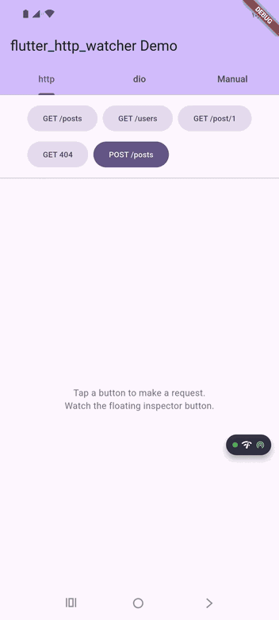
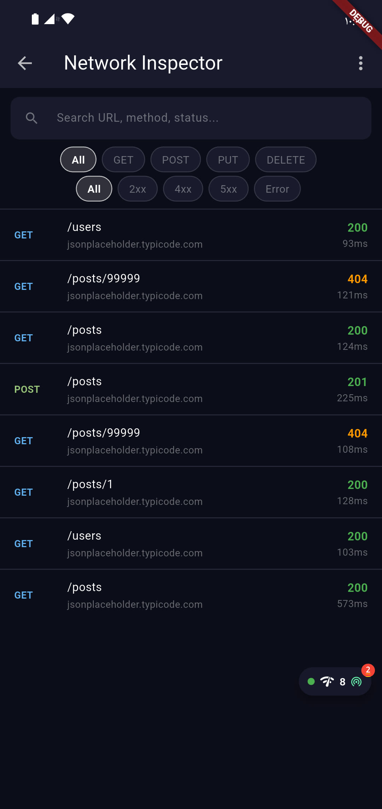
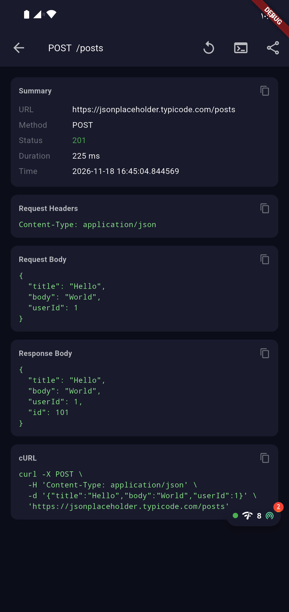
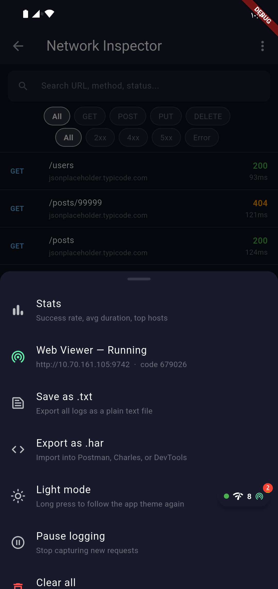
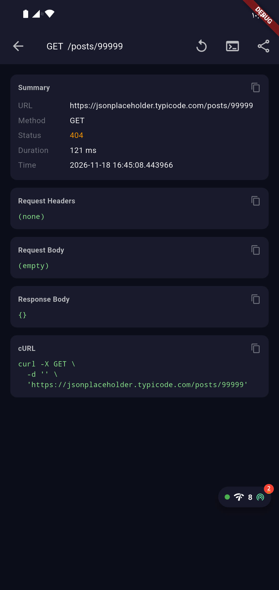
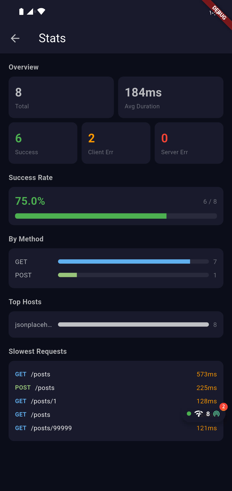
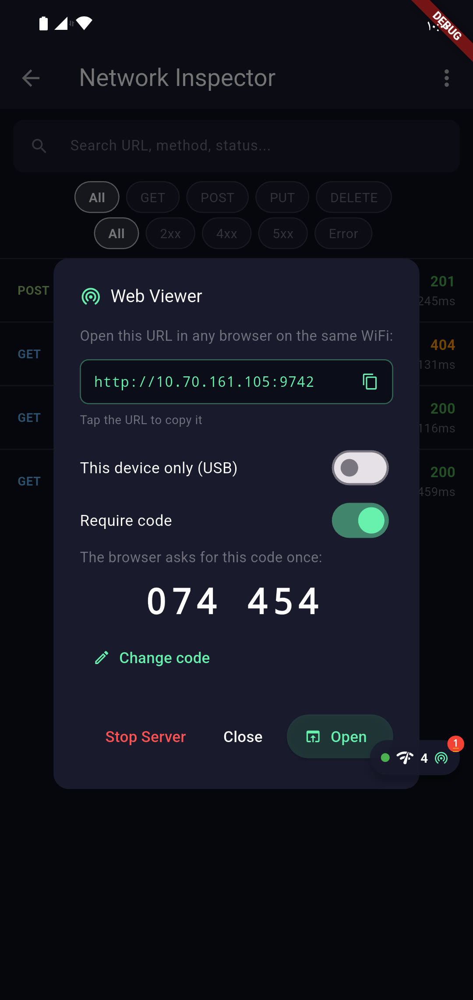

# flutter_http_watcher

A lightweight in-app network inspector for Flutter.  
Works with **any** HTTP client — `http`, `dio`, `retrofit`, `graphql`, or your own. Zero HTTP dependencies.

<p align="center">
  
</p>

---

## Screenshots

<p align="center">
  
  
  
  
  
  
</p>

---

## Features

- Draggable floating button with live request count
- **Live connectivity dot** — green (online) · red (offline) · grey (unknown)
- **Error badge** — red badge on the floating button shows 4xx / 5xx / failed count
- **Custom icon** — replace the default button icon via `HttpWatcherOverlay(icon: ...)`
- Color-coded by HTTP method (GET / POST / PUT / DELETE)
- Color-coded status codes (green 2xx · orange 4xx · red 5xx)
- Search bar + method & status code filter chips
- Full request & response viewer with JSON pretty-printing
- **cURL export** — copy any request as a `curl` command
- **Request replay** — re-send any logged request with one tap
- **Stats screen** — success rate, avg duration, top hosts, slowest requests
- **Export logs** — save as `.txt` or export as `.har` (Postman / Charles / DevTools compatible)
- **Web Viewer** — open live logs in any browser on the same WiFi network, optionally auto-started in debug builds
- Follows your app's light / dark theme — with a manual override
- One-tap copy · share full request as text
- Pause / resume logging
- Works with **any** HTTP client — zero HTTP dependencies
- Controlled entirely by the `show` flag — use in debug, release, or staging

---

## Installation

```yaml
dependencies:
  flutter_http_watcher: ^1.4.0
```

---

## Setup

### 1 — Wrap your app

Add `HttpWatcherOverlay` as the outermost widget in your `MaterialApp` builder. It requires your app's `navigatorKey` so it can open the inspector screen above your navigation stack.

```dart
import 'package:flutter_http_watcher/network_inspector.dart';

final navigatorKey = GlobalKey<NavigatorState>();

MaterialApp(
  navigatorKey: navigatorKey,
  builder: (context, child) {
    return HttpWatcherOverlay(
      navigatorKey: navigatorKey,
      show: true, // set to false to hide the button entirely
      child: child!,
    );
  },
);
```

> **Using GetX?** Pass `Get.key` as the `navigatorKey`.  
> **Using go_router?** Pass your `GlobalKey<NavigatorState>` the same way.

---

### 2 — Log requests

The package has **no built-in HTTP client**. Copy one of the adapters below into your project and use it instead of your normal client.

#### `http` package

```dart
import 'dart:convert';
import 'package:http/http.dart' as http;
import 'package:flutter_http_watcher/network_inspector.dart';

class WatcherHttpClient extends http.BaseClient {
  final http.Client _inner;
  WatcherHttpClient([http.Client? inner]) : _inner = inner ?? http.Client();

  @override
  Future<http.StreamedResponse> send(http.BaseRequest request) async {
    final start = DateTime.now();
    final streamed = await _inner.send(request);
    final bytes = await streamed.stream.toBytes();
    HttpWatcherLogger.instance.logRequest(
      method: request.method,
      url: request.url.toString(),
      headers: Map<String, String>.from(request.headers),
      body: request is http.Request ? request.body : null,
      statusCode: streamed.statusCode,
      responseBody: utf8.decode(bytes, allowMalformed: true),
      startTime: start,
    );
    return http.StreamedResponse(Stream.value(bytes), streamed.statusCode,
        headers: streamed.headers, contentLength: bytes.length);
  }

  @override
  void close() => _inner.close();
}
```

Use it like this:
```dart
final client = WatcherHttpClient();
final response = await client.get(Uri.parse('https://api.example.com/users'));
```

#### `dio`

Add this interceptor to your `Dio` instance:

```dart
import 'package:dio/dio.dart';
import 'package:flutter_http_watcher/network_inspector.dart';

class WatcherDioInterceptor extends Interceptor {
  final _starts = <int, DateTime>{};

  @override
  void onRequest(RequestOptions o, RequestInterceptorHandler h) {
    _starts[o.hashCode] = DateTime.now();
    h.next(o);
  }

  @override
  void onResponse(Response r, ResponseInterceptorHandler h) {
    final start = _starts.remove(r.requestOptions.hashCode) ?? DateTime.now();
    HttpWatcherLogger.instance.logRequest(
      method: r.requestOptions.method,
      url: r.requestOptions.uri.toString(),
      headers: r.requestOptions.headers.map((k, v) => MapEntry(k, v.toString())),
      body: r.requestOptions.data,
      statusCode: r.statusCode ?? 0,
      responseBody: r.data?.toString() ?? '',
      startTime: start,
    );
    h.next(r);
  }

  @override
  void onError(DioException e, ErrorInterceptorHandler h) {
    final start = _starts.remove(e.requestOptions.hashCode) ?? DateTime.now();
    HttpWatcherLogger.instance.logRequest(
      method: e.requestOptions.method,
      url: e.requestOptions.uri.toString(),
      headers: e.requestOptions.headers.map((k, v) => MapEntry(k, v.toString())),
      body: e.requestOptions.data,
      statusCode: e.response?.statusCode ?? 0,
      responseBody: e.response?.data?.toString() ?? e.message ?? '',
      startTime: start,
    );
    h.next(e);
  }
}
```

Add it to your `Dio` instance:
```dart
final dio = Dio();
dio.interceptors.add(WatcherDioInterceptor());
```

#### Any other client (manual)

Call `logRequest` manually after every response:

```dart
final start = DateTime.now();
final response = await myClient.get(uri);

HttpWatcherLogger.instance.logRequest(
  method: 'GET',
  url: uri.toString(),
  statusCode: response.statusCode,
  responseBody: response.body,
  startTime: start,
);
```

#### Show the request before the response arrives (two-phase)

To make a request appear in the inspector **the instant it's sent** — shown with a
spinner as *pending* — and then fill in the response when it completes, log it in
two steps. This is handy for slow or long-running requests:

```dart
final id = HttpWatcherLogger.instance.logRequestStart(
  method: 'GET',
  url: uri.toString(),
  headers: headers,
);

try {
  final response = await myClient.get(uri);
  HttpWatcherLogger.instance.logResponse(
    id: id!,
    statusCode: response.statusCode,
    responseBody: response.body,
  );
} catch (e) {
  HttpWatcherLogger.instance.failRequest(id: id!, error: e.toString());
}
```

The duration is computed automatically from when `logRequestStart` was called.

---

## Inspector screen

Tap the floating button to open the inspector. All options are in the **⋮ menu** (top-right corner):

| Option | Description |
|--------|-------------|
| **Stats** | Success rate, average duration, by-method breakdown, top hosts, slowest requests |
| **Save as .txt** | Export all logs as a plain text file and share it |
| **Export as .har** | Export in HAR format — importable in Postman, Charles Proxy, or browser DevTools |
| **Dark / Light mode** | Pin the inspector theme; long-press to follow the app again |
| **Pause / Resume** | Stop or start capturing new requests |
| **Clear all** | Delete all logged requests |

### Request list

- Requests are shown newest-first with method, URL path, status code, and duration
- Use the **search bar** to filter by URL, method, or status code
- Use the **method chips** (GET / POST / PUT / DELETE) to filter by HTTP method
- Use the **status chips** (2xx / 4xx / 5xx / Error) to filter by response type

### Request detail

Tap any request row to open the detail screen. From here you can:

| Action | How |
|--------|-----|
| **Copy as cURL** | Tap the cURL icon in the app bar — ready to paste in any terminal |
| **Replay request** | Tap the replay icon — re-sends the exact same request and logs the new response |
| **Share** | Tap the share icon to share the full request + response as text |
| **Copy section** | Tap the copy icon next to any section (headers, body, response) |

---

## Floating button

The floating button is **draggable** — press and drag it to any edge of the screen.

| Element | Meaning |
|---------|---------|
| 🟢 / 🔴 / ⚪ dot | Live connectivity status (online / offline / unknown) |
| Number | Total logged request count |
| Red badge | Number of 4xx / 5xx / failed requests since last clear |
| ▶ icon | Logging is paused — tap to resume |
| Green 📡 icon | The Web Viewer server is running |

---

## Connectivity indicator

The dot on the floating button reflects live network connectivity, checked every 5 seconds.

| Color | Meaning |
|-------|---------|
| 🟢 Green | Device has an active internet connection |
| 🔴 Red | Device is offline |
| ⚪ Grey | Status not yet determined (app just started) |

---

## Stats screen

Open via **⋮ → Stats**. Shows:

- Total requests, success count, client error count, server error count
- Success rate progress bar
- Average response duration
- By-method breakdown (GET / POST / PUT / DELETE)
- Top 5 hosts by request count
- Top 5 slowest requests

---

## Web Viewer

Start a local HTTP server on the device and open the logs in any browser on the **same WiFi network** — useful for viewing on a laptop while the app runs on a phone.

1. Tap **⋮ → Web Viewer**
2. The server starts and shows a URL (e.g. `http://192.168.1.5:9742`) and a 6-digit pairing code. Both are also printed to the debug console
3. Open the URL in any browser on the same WiFi and enter the code
4. The page updates every 3 seconds with new requests

The logs contain auth tokens and full request/response bodies, so each browser
has to enter the code once before it sees anything. It then stays paired until
the app restarts or the server is stopped. A new code is made each time the
server starts. Each device trying codes gets one try per second, and after 5
wrong codes in a row it is locked out for 30 seconds; other devices, including
yours, are not affected. After 50 wrong codes overall the phone shows a new
code. If the server restarts itself after a dropped connection, it keeps the
code and paired browsers, so an open page reconnects.

The server answers only requests addressed to the phone's IP, `localhost` or
`127.0.0.1`, which stops websites from reaching it through DNS rebinding, and
refuses codes posted from other websites. It listens on the Wi-Fi or Ethernet
address, never on mobile data or a VPN.

**Over USB only.** The Web Viewer uses plain HTTP, so someone who can capture
or redirect traffic on the same Wi-Fi could read the logs and the code. On a
network you don't trust (café, shared office), switch on **This device only
(USB)** in **⋮ → Web Viewer**, or pass `webServerLocalOnly: true`. The server
then listens only on the phone itself. Connect it by USB and run:

```sh
adb forward tcp:9742 tcp:9742   # use the port shown on the phone
```

then open `http://localhost:9742` on the computer.

**Changing or removing the code.** In **⋮ → Web Viewer** on the phone, tap
**Change code** to set your own (6–64 characters, no spaces), **Use random
code** to go back, or turn off **Require code** (debug builds only). These
last until the app restarts. To set them from code instead:

```dart
HttpWatcherOverlay(
  navigatorKey: navigatorKey,
  webServerCode: 'my-team-code',   // fixed code instead of a random one
  // webServerRequiresCode: false, // no code at all — see the warning below
  // webServerLocalOnly: true,     // USB only, via adb forward
  child: child!,
)

// or at runtime:
HttpWatcherLogger.instance.setWebServerCode('my-team-code'); // null = random
HttpWatcherLogger.instance.setWebServerRequiresCode(false);
```

A custom code is never replaced automatically, so pick one that is hard to
guess. Changing the code signs out paired browsers.

> **Warning:** with the code turned off, anyone on the same network can open
> the URL and read every logged header and body, including auth tokens. Only
> do this on a network you trust. The code can only be turned off in debug
> builds; in profile and release builds it always stays on.

The browser page includes:
- Search bar — filter by URL, method, or status
- Method chips (GET / POST / PUT / DELETE)
- Status chips (2xx / 4xx / 5xx / Error)
- Click any row to see full request details
- **Copy** buttons on every section (URL, cURL, headers, request body, response body)

```dart
// Control programmatically:
await HttpWatcherLogger.instance.startWebServer();
print(HttpWatcherLogger.instance.webServerUrl); // http://192.168.x.x:9742
print(HttpWatcherLogger.instance.webServerPairingCode); // e.g. 482913
await HttpWatcherLogger.instance.stopWebServer();
```

### Start automatically in debug

Set `autoStartWebServer: true` and the server starts as soon as the app
launches, so you can open the logs in a browser without touching the phone:

```dart
HttpWatcherOverlay(
  navigatorKey: navigatorKey,
  autoStartWebServer: true, // debug builds only
  child: child!,
)
```

The URL and code are printed to the debug console
(`[HttpWatcher] Web Viewer running at http://192.168.x.x:9742 — pairing code 482913`) and a green
icon appears on the floating button while the server runs. The option is
ignored in profile and release builds, on Flutter web, and while `show` is
`false`. If you stop the server from the inspector, it stays stopped until the
next launch.

> **Note:** The web viewer runs on port `9742` by default. If that port is already in use (e.g. a second app instance is running), it automatically scans upward (`9743`, `9744`, …) for the first free port — so you can run several apps at once, each with its own viewer. The chosen port is shown in the URL. Make sure your device firewall allows connections on that port range.

---

## Configuration

```dart
// Disable logging at runtime (overlay stays visible, no new logs captured):
HttpWatcherLogger.instance.enabled = false;

// Toggle logging on/off:
HttpWatcherLogger.instance.toggleEnabled();

// Change the maximum number of entries kept in memory (default: 300):
HttpWatcherLogger.instance.maxEntries = 100;

// Read the current error count (4xx / 5xx / failed requests):
final errors = HttpWatcherLogger.instance.errorCount;
```

### Theme

By default the inspector follows your app's brightness, so it matches whatever
`ThemeData` is in effect — including a device that boots in dark mode.

```dart
// Default — match the host app:
HttpWatcherLogger.instance.themeMode = WatcherThemeMode.system;

// Pin the inspector to one palette regardless of the app:
HttpWatcherLogger.instance.themeMode = WatcherThemeMode.dark;
HttpWatcherLogger.instance.isDark = true; // equivalent shorthand

// Hand control back to the app:
HttpWatcherLogger.instance.followAppTheme();
```

In the inspector, tapping the theme row pins the opposite palette and
long-pressing it returns to following the app.

### Custom icon

Replace the default `network_check` icon with any Flutter `IconData`:

```dart
HttpWatcherOverlay(
  navigatorKey: navigatorKey,
  icon: Icons.bug_report_outlined, // any IconData
  child: child!,
)
```

### Hide in production

Control visibility with the `show` flag — no need to remove any code:

```dart
HttpWatcherOverlay(
  navigatorKey: navigatorKey,
  show: kDebugMode, // true in debug, false in release
  child: child!,
)
```

---

## License

MIT
